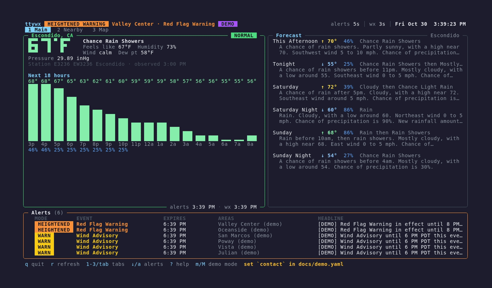

# ttywx

A btop-style terminal dashboard for live National Weather Service data:
current conditions, forecasts, a map, and active alerts for the places you
care about, with a four-level threat mode that turns into a flashing
**TAKE COVER** banner when it matters.

<!-- Record with: go build -o ttywx . && vhs docs/demo.tape -->


- Works anywhere the NWS covers: all 50 states, DC, Puerto Rico, Guam, the
  US Virgin Islands, American Samoa and the Northern Mariana Islands.
- Data comes only from [api.weather.gov](https://www.weather.gov/documentation/services-web-api).
  You don't need an API key or an account.
- Imperial or metric, 12- or 24-hour clock.
- A single static binary for Linux, macOS, Windows and FreeBSD.

ttywx started life as [escowx](https://github.com/j4mes/escowx), a dashboard
for one corner of San Diego County.

## Install

Download a binary from the [releases page](https://github.com/j4mes/ttywx/releases),
or with Go 1.24+:

```sh
go install github.com/j4mes/ttywx@latest
```

Or build from source:

```sh
git clone https://github.com/j4mes/ttywx && cd ttywx
CGO_ENABLED=0 go build -o ttywx .
```

## Getting started

Run `ttywx`. The first time, it asks where you are and writes a config file:

```
$ ttywx
Welcome to ttywx! There's no config at ~/.config/ttywx/config.yaml yet, so let's make one.
ttywx shows National Weather Service data, which covers the US and its territories.

Your main location ("City, ST", ZIP code, or lat,lon): Springfield
Which one?
   1) Springfield, MO (Greene)
   2) Springfield, IL (Sangamon)
   3) Springfield, MA (Hampden)
   ...
```

Add more places at any time:

```sh
ttywx add "Boulder, CO"
ttywx add 10001                      # ZIP code
ttywx add 44.2706,-71.3033 --name "Mt Washington"
ttywx add "Denver, CO" --primary     # show it on the Main tab
ttywx remove Boulder
```

Place names are looked up with the free [Open-Meteo geocoding
API](https://open-meteo.com/en/docs/geocoding-api). That is the only request
ttywx makes anywhere other than api.weather.gov, and it happens only when you
add a place.

## Usage

```sh
ttywx                 # full-screen dashboard
ttywx --once          # plain-text summary, then exit (for scripts/cron)
ttywx --demo          # inject fake alerts to preview every mode
ttywx --config ./other.yaml --contact me@example.com
ttywx --version
```

`--once` exits 0 on success and 1 if no location could be loaded. It can be
combined with `--demo`.

## Config

The config lives at `~/.config/ttywx/config.yaml`. ttywx respects
`$XDG_CONFIG_HOME`, uses the platform equivalent on macOS and Windows, and
`--config` points it elsewhere. `ttywx add` / `remove` edit the file in place
and keep your comments and formatting. You can also edit it by hand:

```yaml
contact: you@example.com      # sent in the User-Agent; NWS asks for real contact info
units: imperial               # or metric (°C, km/h, hPa; also metric forecast text)
clock: 12h                    # or 24h
refresh:
  alerts: 60s
  forecast: 10m               # observations + forecasts
# log_file: ~/ttywx.log       # default: ~/.local/state/ttywx/ttywx.log
bell: true                    # terminal bell on entering TAKE COVER
notify: true                  # desktop notification (notify-send / osascript)
locations:
  - { name: Denver,  lat: 39.7392, lon: -104.9847, primary: true }
  - { name: Boulder, lat: 40.0150, lon: -105.2705 }
```

The contact can also be set with `--contact` or `TTYWX_CONTACT`. The location
marked `primary` gets the Main tab.

## Threat modes

| Mode | Color | Triggered by (examples) |
|---|---|---|
| NORMAL | green | no alerts, Statements, Outlooks |
| WARNING | yellow | Advisories and Watches |
| HEIGHTENED WARNING | orange | Warnings (Red Flag, High Wind, Flash Flood, Winter Storm, …) |
| TAKE COVER | red, flashing banner | Tornado / Extreme Wind / Tsunami Warning, Flash Flood or Tornado Emergency, civil emergencies, or any Extreme + Immediate alert |

The event→mode table lives in [`modes/events.go`](modes/events.go). Events
not in the table fall back to severity ("Severe" → HEIGHTENED), then wording
("…Warning", "…Watch", …). Each location shows its worst live alert; the header
shows the worst location overall. Mode changes are appended to
`~/.local/state/ttywx/ttywx.log` (`$XDG_STATE_HOME` is respected). Entering
TAKE COVER also rings the terminal bell and sends a desktop notification
(both can be turned off).

## Tabs

- **1 Main**: the primary location (or one you opened from another tab): current
  conditions, an hourly temperature/rain strip, and the detailed forecast.
- **2 Nearby**: cards for every other location: mode, temperature, conditions,
  wind, humidity, a 12-hour trend, and active alerts.
- **3 Map**: every location plotted at its real position over a colored field
  interpolated between them. Press `v` to switch layers: **temperature** (with
  wind arrows), **threat** (each area colored by its nearest location's mode),
  or **rain chance** this hour.

The alerts pane (every active alert, worst first) and the TAKE COVER banner
appear on every tab.

## Keys

| Key | Action |
|---|---|
| `q` / `ctrl+c` | quit |
| `r` | refresh everything now |
| `1` `2` `3` / `tab` / `shift+tab` | switch tabs |
| arrows / `hjkl` | Nearby: move around the grid · Map: jump to the nearest place in that direction · ↓ past the bottom enters the alerts pane |
| `enter` | open the selected place on Main; in the alerts pane, open the full alert |
| `esc` | leave the alerts pane / return Main to the primary location / close |
| `a` | jump to the alerts pane |
| `v` | Map: cycle layers |
| `?` | help |
| `m` / `M` | demo mode only: cycle the current location's mode, or every location's |

## Behavior notes

- Each location's `/points` lookup and station list are fetched once at startup and cached.
- Requests time out, retry 5xx/429 with exponential backoff, and never blank
  the screen. If a refresh fails, the last good data stays up with a **STALE** marker.
- Observations come from the location's nearest station. If its latest report
  has no temperature (common with personal weather stations), ttywx tries the
  next nearest station, up to five. Sky text falls back to the current hourly forecast.
- A location outside NWS coverage gets a clear message instead of endless
  retries.

## Development

```sh
go test ./...
go run . --demo
```

```
api/      NWS client, types, unit conversion
geo/      place-name lookup (Open-Meteo) for `ttywx add` and first-run setup
units/    imperial/metric and 12/24h formatting
config/   config.yaml loading, template, and in-place location edits
modes/    alert → threat-mode classification (+ tests with sample alert JSON)
wx/       per-location state, fetch orchestration, alert merging
ui/       Bubble Tea model and views (mapview.go: the Map tab)
tracker/  mode-change log, bell, desktop notifications
demo/     fake alerts for --demo
docs/     README recording (demo.tape) and its config
```

To make a release, push a tag: `git tag v1.0.0 && git push --tags`. GitHub
Actions runs [goreleaser](https://goreleaser.com) to build the binaries and
publish them on the releases page.

## License

MIT, see [LICENSE](LICENSE).
